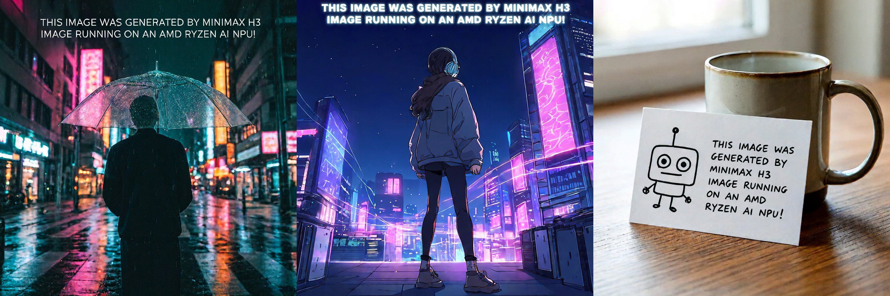

# MiniMax-H3-Image on the AMD Ryzen AI NPU

AMD Ryzen AI NPU (XDNA 2) port of the [MiniMax-H3-Image](https://huggingface.co/MiniMaxAI/MiniMax-H3-Image) six-step text-to-image model at 1024×1024.

This repository holds the setup, generation and conversion scripts. `setup.ps1` downloads the NPU model files from [Tomoali/MiniMax-H3-Image-ryzen-ai-npu](https://huggingface.co/Tomoali/MiniMax-H3-Image-ryzen-ai-npu).




The AI-generated samples show `cafe-board`, `neon-open`, `station-board` and `birthday-card` from left to right, all with seed 1234.

## What runs where

| Stage | Runs on | Precision and shape |
|---|---|---|
| Qwen3-VL-32B text encoder and token refiner | CPU | The first 50 text layers stream bf16 weights and compute in fp32. Up to 256 tokenizer tokens |
| Diffusion transformer | NPU and CPU | 50 layers × six steps. Four int4/bf16 projections and DynamicDispatch attention on the NPU. The CPU handles modulation, normalization outside attention, activation, residuals and the schedule |
| ViT decoder | NPU and CPU | 24 layers on 25 overlapping tiles. The four int4/bf16 projections run on the NPU and attention runs on the CPU. `-Vae cpu` uses the Diffusers fp32 decoder |

[How it works](docs/how-it-works.md) describes the graph splits, memory use and process lifetime.

## Verified configuration

| | |
|---|---|
| Processor | AMD Ryzen AI 7 PRO 350, 8 cores and 16 logical processors |
| Memory | 32 GB |
| OS | Windows 11 Home, build 26300 |
| NPU driver | 32.0.203.329 |
| Ryzen AI Software | 1.8.0 |
| NPU power mode | Turbo |
| Power source | AC |

## Install

- [Ryzen AI Software 1.8.0](https://ryzenai.docs.amd.com/en/1.8/inst.html) with its NPU driver and GenAI-SD. Use `-RyzenPath` for a custom installation and `-GenAiSdPath` for a separate GenAI-SD folder.
- Miniforge or another conda installation, PowerShell 7 and Git.
- About 90 GB of free SSD space for installation. See [Disk](#disk) for the measured sizes.

```powershell
git clone https://github.com/tomhda/minimax-h3-image-ryzen-ai-npu
cd minimax-h3-image-ryzen-ai-npu
pwsh -NoProfile -File .\setup.ps1
pwsh -NoProfile -File .\doctor.ps1
```

`setup.ps1` performs five steps.

1. Creates `h3npu-npu` from the Ryzen AI Software `env.yaml`, the AMD wheels and `environments/npu-extra.txt`.
2. Creates `h3npu-text` with Python 3.12.16, PyTorch 2.15.0 CPU, `environments/text.txt` and pinned Diffusers.
3. Downloads the files listed in `manifest.json` into `parts\` at the commit set in `configs/example.json` and verifies their sizes and SHA256 hashes. The list includes `LICENSE` and `NOTICE`. The model card, `.gitattributes` and files under `images/` are excluded from the check. Pass `-HfRevision` to select another full commit hash or `-SkipParts` to verify a local copy without downloading it.
4. Downloads the image tokenizer, the VAE files and the text encoder files from pinned MiniMax revisions. The original diffusion transformer shards are required only for rebuilding.
5. Writes `configs/local.json` for generation and diagnostics.

Use `-MiniMaxPath` for an existing image model folder and `-TextEncoderPath` for an existing `text_encoder` folder. If `text_encoder` is inside the image model folder, setup detects it. `-NpuEnv` and `-TextEnv` select environment names. The scripts call each environment's Python directly.

```powershell
pwsh -NoProfile -File .\setup.ps1 -MiniMaxPath <image-model-folder> -TextEncoderPath <text-encoder-folder> -VerifyModels -SkipDownloads
```

`-SkipDownloads` verifies the local parts and requires local model files. `-VerifyModels` checks each required upstream file's size and SHA256 against its pinned revision. It fetches reference bytes for small files stored directly in Git.

`doctor.ps1` prints the processor, memory, NPU driver, configured paths and package versions. It checks that the model inputs are present and verifies the parts against the release manifest or the local conversion manifests, then runs the first transformer layer on the NPU and checks for finite output. It prints `"ok": true` and `probe exit 0` when the probe passes.

### Disk

| | 1024² |
|---|---:|
| MiniMax files downloaded by default | 56.04 GB |
| NPU parts (Hugging Face) | 21.81 GB |
| Two conda environments | 9.17 GB |

## First image

```powershell
pwsh -NoProfile -File .\gen.ps1 -Items .\examples\one.json -Out .\outputs\first
```

```json
[
  {
    "id": "cafe-board",
    "prompt": "A chalkboard menu standing outside a small cafe that reads 'COFFEE 450円' in white chalk, morning light, realistic photo.",
    "seed": 1234
  }
]
```

The image is written to `<Out>\<id>_s<seed>.png`. Final decoder latents and text embeddings are saved in `latents/` and `text/`. The output folder gets `gen_summary.json`, `text_log.json`, `dit_log.json` and `vae_log.json`. Each item in the list runs through all three stages.

| Option | Values |
|---|---|
| `-Vae` | `npu` (default) or `cpu` |
| `-Affinity` | `auto` (default) selects the highest EfficiencyClass. `off` uses the inherited affinity |
| `-DitRestart` | `3` (default), `1` or `off`. Number of denoising steps per worker |
| `-TextThreads`, `-ReadWorkers` | Text inference and parallel shard read workers. Defaults 4 and 8 |
| `-DitThreads`, `-VaeThreads` | Host threads for the transformer and decoder. Default 2 each |
| `-Config` | Config path. Default `configs/local.json` |

Exit codes are `0` for all images complete, `3` for prompts over the 256-token limit that were skipped, `2` for bad input or an output folder in use, and `1` for generation failure. `SKIP id=... tokens=...` identifies a skipped prompt. Each successfully generated image replaces any existing PNG with the same filename in the output folder.

The six sample prompts can be run in one invocation.

```powershell
pwsh -NoProfile -File .\gen.ps1 -Items .\examples\repro_1024.json -Out .\outputs\repro
```

## Measured

On the verified machine at 1024×1024 with the default options and a 5 GB free-memory floor.

| Device | Resolution | Steps | End-to-end time per image, median | Mean | Minimum–maximum | DiT inference speed |
|---|---|---:|---:|---:|---:|---:|
| Ryzen AI 7 PRO 350, 32 GB, NPU power mode Turbo | 1024×1024 | 6 | 368 s | 369 s | 352–389 s | 28.6 s/step |

| Stage | Time per image |
|---|---:|
| Text encoder load and conversion | 17.9 s |
| Text encoder inference | 15.2 s |
| DiT session creation | 104.8 s |
| DiT inference, 6 steps | 171.7 s |
| DiT session release | 19.8 s |
| VAE session creation | 2.6 s |
| VAE inference | 21.9 s |
| VAE session release | 2.4 s |

| Memory, one image | Peak |
|---|---:|
| Private bytes of the generation processes: text encoder stage | 3.86 GB |
| Private bytes of the generation processes: DiT stage | 2.91 GB |
| Private bytes of the generation processes: decoder stage | 1.98 GB |
| NPU shared memory of the generation processes (allocated from system RAM) | 1.92 GB |
| Private bytes and NPU shared memory at the same moment | 4.33 GB |
| Decrease in free physical memory | 4.05 GB (11.32 GB → 7.26 GB) |

- Six back-to-back end-to-end executions: the six prompts in `examples/repro_1024.json` (27–43 text tokens) with seed 1234. The stage times and the DiT inference speed are medians of the six.
- Every image goes through all stages. The NPU sessions are created and released for each image.
- The memory values come from a separate execution of `cafe-board` with seed 1234, with process and NPU memory sampled once per second. That execution took 321 s. Generation stops when free physical memory falls below the floor (`min_available_gb`, 5 GB by default).
- CPU time / wall time was 0.92: user and system time of the generation processes divided by the wall time, about one logical processor busy on average. Minimum free physical memory in the six executions was 5.38 GB.
- Text reads overlap inference in the preceding layer. Later DiT workers import during denoising, and decoder startup overlaps the last step.
- Peak GPU engine utilization for generation processes was 0.00% in one-second Windows counter samples.
- All six images completed with finite latents and decoder outputs. The run recorded 0 display-driver resets and 0 new live kernel dumps.

## Differences from the official pipeline

- **Precision and composition.** The four NPU projections use int4 weights and bf16 inputs and outputs. For `cafe-board`, seed 1234, the NPU transformer followed by the fp32 decoder differed from the fp32 CPU implementation of the official equations by 0.437 in final-latent relative L2 and 14.80 dB in PNG PSNR. The comparison used direct 1024×1024 generation for both.
- **Text in images.** The six prompts in `examples/repro_1024.json` were generated with seed 1234 and read at full size. Five images show the requested text. `price-tag` shows りんど where the prompt asks for りんご. The fp32 CPU implementation of the official equations shows the same りんど with seeds 1234 and 42.

  | ID | Requested | In the image |
  |---|---|---|
  | cafe-board | COFFEE 450円 | COFFEE 450円 |
  | neon-open | OPEN 24 HOURS | OPEN 24 HOURS |
  | station-board | 東京 9:41 | 東京 9:41 |
  | birthday-card | Happy Birthday Mekamoto / 2026.11.15 | Happy Birthday Mekamoto / 2026.11.15 |
  | concert-poster | SILVER NIGHT / DEC 24 19:00 | SILVER NIGHT / DEC 24 19:00 |
  | price-tag | りんご 3個 298円 | りんど 3個 298円 |

- **Repeat runs.** The same prompt and seed do not always give the same latent. In 27 runs with the default options, 20 final latents matched an earlier run of the same prompt and seed bit for bit and 7 did not. The cause is unknown.

## Rebuilding the parts

```powershell
pwsh -NoProfile -File .\setup.ps1 -SkipParts -WithDiTWeights
pwsh -NoProfile -File .\convert.ps1 -Verify
```

Building requires 66.29 GB of additional MiniMax files, including the diffusion transformer weights, schedule and output heads. Allow disk space for a second set of parts and the conversion working directory, which peaked at 0.44 GB in the layer conversion measurement.

The converter builds the 200 DiT projections, 50 attention graphs, 96 VAE projections, common casts and CPU tensors, and extracts the text refiner tensors. It partitions and compiles the attention graphs with Ryzen AI Software 1.8.0. Re-run the same command to resume from completed units. The converter checks the recorded file sizes before reusing a unit. `-Verify` checks for finite output from a complete layer of each stage.

The DiT and VAE conversion took 19.8 minutes on the verified machine, including a stop and resume after the first transformer layer. The rebuilt DiT layers 0, 24 and 49 and VAE layers 0 and 23 gave bit-identical outputs to the reference parts on fixed inputs. All 19 refiner tensors match the corresponding upstream tensor data bit for bit.

The default destination is `rebuild\`. Use `-Out` to choose a different directory. To use rebuilt parts, set `parts_path` in `configs/local.json` to the build directory, then run `doctor.ps1` and generate images as usual.

## Repository layout

| Path | Contents |
|---|---|
| `setup.ps1`, `convert.ps1`, `doctor.ps1`, `gen.ps1` | PowerShell entry points |
| `src/` | Text encoder, transformer, decoder and process management |
| `tools/convert/` | Local conversion, partition strategy and finite-output checks |
| `tools/download_models.py`, `tools/make_manifest.py` | Pinned model downloads and SHA256 manifests |
| `configs/example.json` | Revisions and local config layout |
| `environments/` | Pinned packages for both environments |
| `examples/` | One-image and six-image prompt lists |
| `validation/` | Parts integrity and bit-level output comparisons |
| `docs/how-it-works.md` | Technical notes |

## License

The original scripts use the MIT License ([LICENSE](LICENSE)). The NPU parts are derivatives of MiniMax-H3-Image under the [MiniMax-H3-Image Community License Agreement](LICENSE-MiniMax-H3-Image.txt). Its Applicable Territory is worldwide, excluding the European Union, the United Kingdom, the Republic of Korea and the United States of America. Its Acceptable Use Policy applies.

The text encoder is obtained from [MiniMaxAI/MiniMax-H3](https://huggingface.co/MiniMaxAI/MiniMax-H3/blob/0919fb684102ef115126612f3fbb84d1027e7317/LICENSE) under the MiniMax H3 COMMUNITY LICENSE AGREEMENT. Its Additional Note identifies Qwen3-VL-32B as licensed under the [Apache 2.0 License](https://github.com/QwenLM/Qwen3-VL/blob/main/LICENSE).

This port is unofficial. See [NOTICE](NOTICE) for source and license details.
